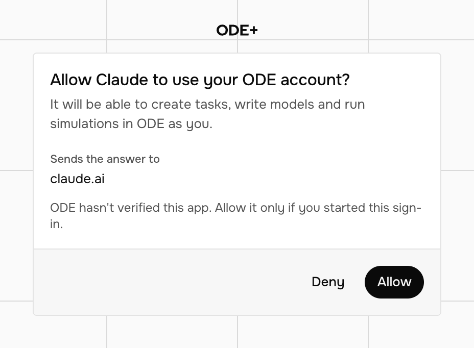
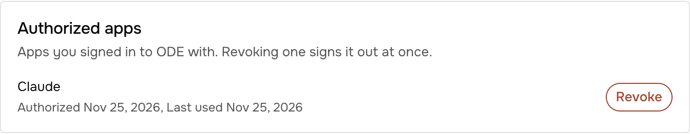
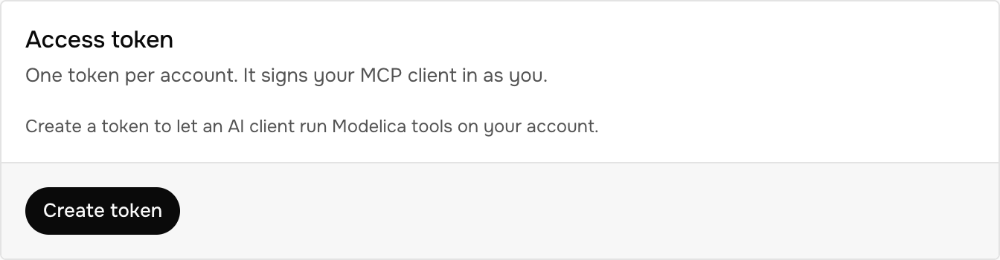

<p align="center">
  
</p>

# ODE Modelica MCP Server

**Build, check and simulate Modelica models in [ODE+](https://www.ode.plus) from your AI assistant.**

The ODE MCP server connects AI clients that support the [Model Context Protocol](https://modelcontextprotocol.io/) (Claude, OpenAI Codex, Cursor and others) to your ODE+ account. Your assistant can create tasks, write and check Modelica models, run simulations in the ODE cloud and read the results. Everything it does is saved to your ODE+ workspace, so you can open the same task in ODE+ to keep working.

  

---

## Quick start

**Server URL:**

```
https://mcp.ode.plus/mcp
```

You sign in with your ODE+ account the first time you connect. There is no token to copy. If you don't have an account yet, create one at [www.ode.plus](https://www.ode.plus).

### Claude (claude.ai, Claude Desktop)

1. Go to **Settings → Connectors** and choose **Add custom connector**. On Team and Enterprise plans, an organization owner adds it under **Organization settings → Connectors**; each member then clicks **Connect** and signs in with their own ODE+ account.
2. Enter the server URL `https://mcp.ode.plus/mcp`.
3. For sign-in, choose **Sign in now** and, for the OAuth client, **Register automatically**.
4. Sign in to ODE+ in the window that opens and click **Allow**.

### OpenAI Codex (desktop app)

1. Open the **Plugins** tab.
2. Add an MCP server with the URL `https://mcp.ode.plus/mcp`.
3. Click connect, sign in to ODE+ in the browser and click **Allow**.

### Claude Code

```bash
claude mcp add --transport http ode https://mcp.ode.plus/mcp
```

Then run `/mcp` inside Claude Code and choose **ode** to sign in.

### Cursor

Add this to your `mcp.json`:

```json
{
  "mcpServers": {
    "ode": { "url": "https://mcp.ode.plus/mcp" }
  }
}
```

Cursor then asks you to sign in.

### Other MCP clients

Any client that supports remote MCP servers over **Streamable HTTP** with **OAuth** can connect using the server URL above. The server publishes its sign-in details through the standard MCP discovery (OAuth protected resource metadata), and clients register automatically.

---

## Signing in

When a client connects for the first time, ODE+ asks you to confirm in the browser:

<p align="center"></p>

The page names the app and the address it will receive the answer on. Only allow it if you started the sign-in yourself.

## Managing access

On **[www.ode.plus/mcp](https://www.ode.plus/mcp)**, **Authorized apps** lists every app you have connected. **Revoke** signs that app out immediately; it has to ask you again before it can use ODE+.

<p align="center"></p>

---

## What your assistant can do

| Tool | What it does |
|---|---|
| `list_tasks` | Lists your recent ODE tasks, with links |
| `create_task` | Creates a new task with a Component (Modelica) app |
| `write_model` | Saves Modelica code into a task. Updates the model with the same class name, or adds a new one. The syntax is checked on save |
| `read_model` | Reads a model's source code, or lists the models in a task |
| `check_model` | Compiles and initialises a model and returns the compiler's messages |
| `quick_simulate` | Runs a task's model in the ODE cloud and returns key values per variable and a short preview of the curves. The run is saved to the task |
| `get_run_result` | Reads a saved run again, for the variables you choose |
| `get_link` | Gives a link that opens the task, or a model in it, in ODE+ |
| `modelica_simulate` | Simulates Modelica code in a scratch environment, without saving it |
| `modelica_get_diagram_url` | Saves Modelica code to a scratch task and links to its diagram |

**Seeing results in ODE+:** every `quick_simulate` run is a normal result of the task. Open the task in ODE+ and use **Results → Load result** to plot it.

**A typical session:** *"Create a task for a tank level PI controller, write the model, check it, simulate 20 seconds and tell me the overshoot."* The assistant uses `create_task` → `write_model` → `check_model` → `quick_simulate` and answers with the numbers and a link to the task.

Some tools, such as `check_model`, are available on paid ODE+ plans.

---

## Connecting with an access token (alternative)

For a client without OAuth support, create an access token on **[www.ode.plus/mcp](https://www.ode.plus/mcp)** and use it in the server URL:

```
https://www.ode.plus/<YOUR_TOKEN>/mcp
```

<p align="center"></p>

- Keep the URL private: anyone who has it can act on your account. You can revoke the token on the same page at any time.
- The older SSE endpoint `https://www.ode.plus/<YOUR_TOKEN>/sse` still works for existing setups. New setups should use Streamable HTTP (`/mcp`).
- Don't configure the same account twice (OAuth and a token URL) in one client: the client would then see every tool twice.

---

## Resources

| Resource | Description |
|---|---|
| [ODE+](https://www.ode.plus) | Modelica modelling and simulation platform |
| [www.ode.plus/mcp](https://www.ode.plus/mcp) | Authorized apps and access tokens |
| [Model Context Protocol](https://modelcontextprotocol.io/) | Official MCP documentation and specification |
| [Modelica](https://modelica.org/) | Modelica language resources |

Questions or problems: open an issue in this repository or contact us at [contact@ode.plus](mailto:contact@ode.plus).

---

**orthogonal supersystems GmbH** · [www.ode.plus](https://www.ode.plus)
